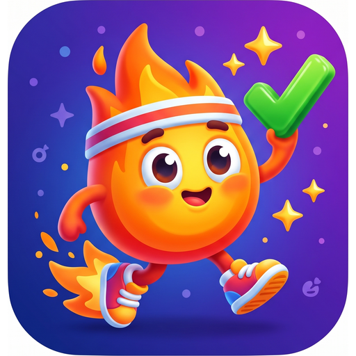
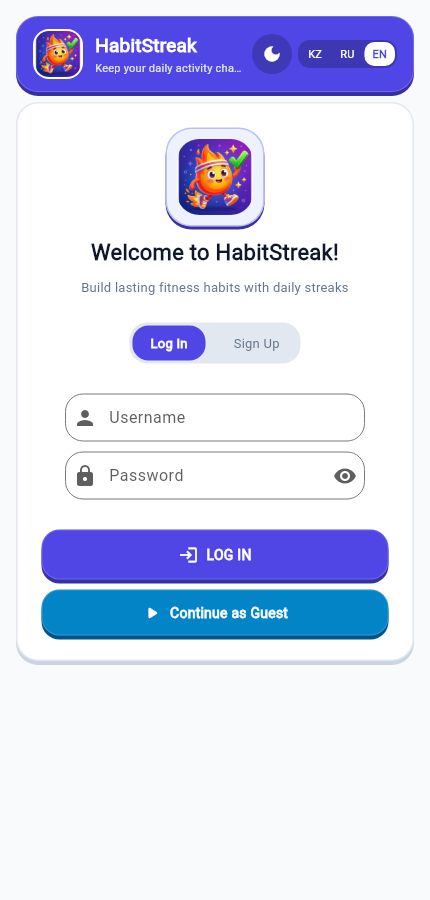
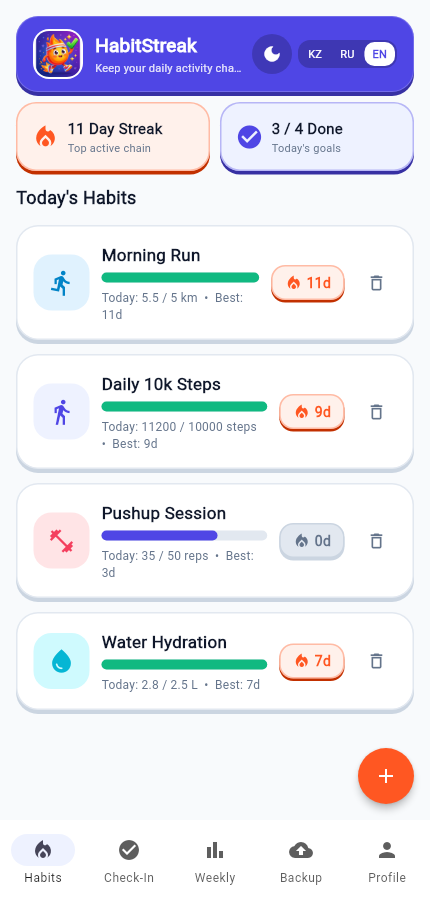
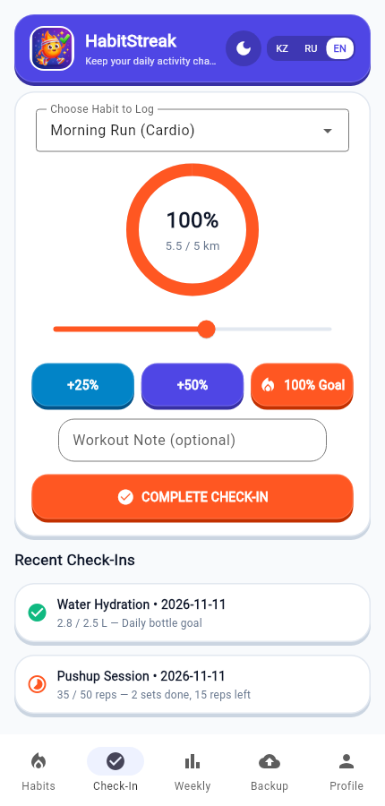
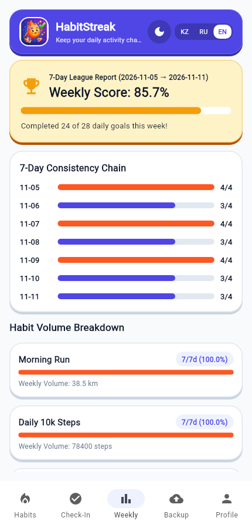
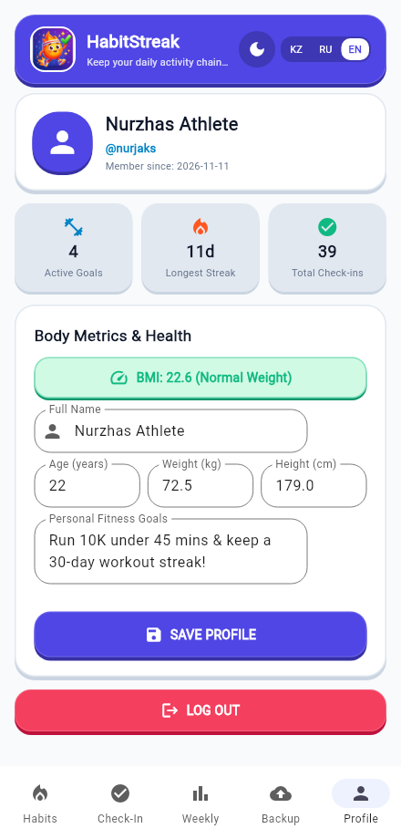
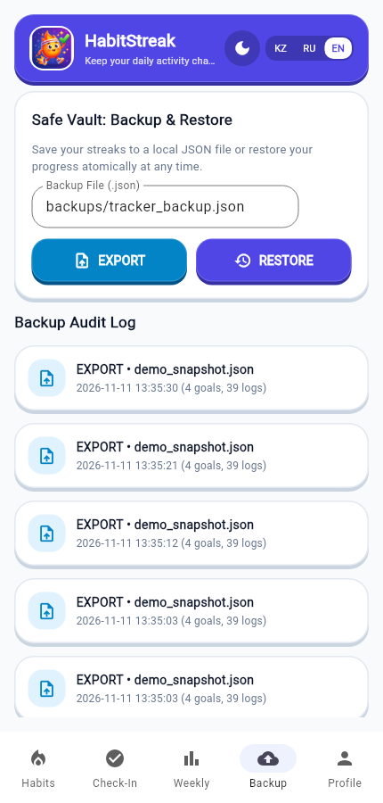
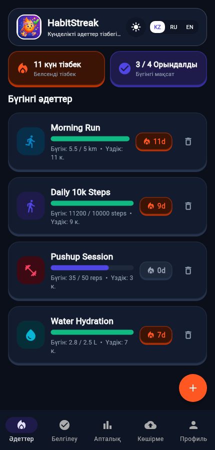

<div align="center">



# 🔥 HabitStreak — Kinetic Fitness & Habit Chain Tracker

**A gamified, offline-first cross-platform mobile activity & habit tracker built with Python, Flet (Flutter), and SQLite.**

[](https://www.python.org/)
[](https://flet.dev/)
[](https://sqlite.org/)
[](#-key-features)
[](#-testing--code-quality)
[](#-testing--code-quality)

</div>

---

## ✨ Overview

**HabitStreak** transforms daily workouts, hydration, step counts, and mobility habits into rewarding, trackable chains. Designed with a custom **Athletic Flat 2.0 3D Tactile UI** (**Kinetic Indigo `#4F46E5`** + **Radiant Flame `#FF5722`**), it delivers instant responsiveness on Android and Desktop with zero cloud lock-in — your workouts, streaks, and body metrics remain 100% private inside local SQLite storage with atomic JSON backup & restore.

### 🚀 Key Features

- **⚡ Custom Athletic Flat 2.0 Design System**: Tactile 3D beveled cards and buttons with zero-blur crisp shadows and category-coded sport iconography (`Cardio`, `Steps`, `Strength`, `Hydration`, `Flexibility`, `Sport`).
- **🌍 Instant Trilingual Support (`KZ` / `RU` / `EN`)**: Switch effortlessly between **Kazakh (Қазақша)**, **Russian (Русский)**, and **English** at any time via the header pill switcher — every label, dialog, alert, and BMI category updates live.
- **🌓 Athletic Studio (Light) & Obsidian Arena (Dark) Themes**: Toggle between a razor-sharp slate-white canvas and a deep obsidian night mode from the top navigation bar.
- **🔐 Local Authentication & Persistent Sessions**: Sign up, log in with **SHA-256 salted password hashing**, or enter immediately via **Continue as Guest**.
- **🏃 Athlete Profile & Real-Time BMI Engine**: Store full name, age, weight (`kg`), height (`cm`), personal fitness goals, and automatically compute **BMI score & health category badge** alongside lifetime streak stats.
- **🔥 Real-Time Streak Engine**: Automatically calculates both **Current Streak** (supporting grace if today hasn't been logged yet, and broken-chain detection) and **Longest Best Streak** per habit.
- **🎯 Interactive Daily Check-In Studio**: Features a circular completion ring, smooth slider control, instant `+25%`, `+50%`, and `100% Goal` boost buttons, plus optional workout notes.
- **🏆 7-Day League Analytics**: Rolling 7-day consistency bars, overall weekly completion percentage, and per-habit volume breakdown.
- **🛡️ Safe Vault (Atomic JSON Backup & Audit Log)**: Export all habits, daily logs, and streaks to portable `.json` files and restore them transactionally with automatic pre-restore audit trail logging.

---

## 📱 Mobile UI Screenshots

### Core User Flow (Light Mode — Athletic Studio)

| Auth & Guest Access | Habits Dashboard | Daily Check-In Studio |
| :---: | :---: | :---: |
|  |  |  |
| *Salted SHA-256 Auth & Guest Mode* | *Kinetic Indigo & Flame Streak Cards* | *Circular Progress Ring & Quick Boosts* |

### Analytics, Profile, Safe Vault & Dark Kazakh UI

| 7-Day Weekly League | Athlete Profile & BMI | Safe Vault Backup | Obsidian Dark Mode (`KZ`) |
| :---: | :---: | :---: | :---: |
|  |  |  |  |
| *Rolling 7-Day Consistency Bars* | *Age, Weight, Height, BMI & Goals* | *Atomic Export/Restore + Audit* | *Obsidian Arena Theme in Kazakh* |

---

## 🎨 Visual Identity & Color System

HabitStreak avoids generic flat green checklists in favor of high-energy athletic tokens engineered for readability in both daylight outdoor training and late-night logging:

| Role | Token | Light (`Athletic Studio`) | Dark (`Obsidian Arena`) |
| :--- | :--- | :---: | :---: |
| **Brand Primary** | `BRAND_PRIMARY` | `#4F46E5` (Kinetic Indigo) | `#4F46E5` (Kinetic Indigo) |
| **Flame Accent / Streak** | `COLOR_FLAME` | `#FF5722` (Radiant Flame) | `#FF5722` (Radiant Flame) |
| **App Canvas** | `bg` | `#F8FAFC` (Slate 50) | `#0B0F19` (Deep Obsidian) |
| **Surface Card** | `card_bg` | `#FFFFFF` (Pure White) | `#131B2E` (Indigo-Slate) |
| **Completion & Health** | `COLOR_MINT` | `#10B981` (Athletic Mint) | `#10B981` (Athletic Mint) |
| **League Trophy** | `COLOR_AMBER` | `#F59E0B` (Sunburst Amber) | `#F59E0B` (Sunburst Amber) |

---

## 🏗️ Architecture & Project Structure

The codebase follows a **clean 5-tier modular architecture** that decouples UI rendering (`tracker/mobile.py`) completely from SQLite persistence (`tracker/db.py`), domain/streak calculations (`tracker/service.py`), authentication & BMI metrics (`tracker/auth.py`), and localization dictionaries (`tracker/i18n.py`):

```text
HabitStreak/
├── main.py                      # Root Flet entrypoint (flet run / flet build apk)
├── seed_demo.py                 # Realistic 10-day sample athlete dataset generator
├── requirements.txt             # Runtime dependency (flet==1.1.2)
├── requirements-dev.txt         # Test & lint dependencies (pytest, pytest-cov, ruff)
├── assets/
│   ├── icon.png                 # App launcher icon & mascot badge
│   └── favicon.png
├── docs/
│   ├── screenshots/             # High-resolution mobile UI screenshots
│   └── 01..10_*.md              # Architecture specs, test plan, manual & explanatory note
├── tracker/
│   ├── __init__.py
│   ├── db.py                    # SQLite connection, PRAGMA foreign_keys & schema DDL
│   ├── service.py               # CRUD, streak calculation, 7-day reports, atomic JSON backup
│   ├── auth.py                  # Salted SHA-256 auth, session table, profile & BMI calculator
│   ├── i18n.py                  # Aligned KZ / RU / EN dictionary (100+ UI keys)
│   └── mobile.py                # 5-tab Flet Athletic Flat 2.0 UI controller & theming
└── tests/
    ├── test_service.py          # 25 unit tests for habits, logs, streaks, reports & backup
    ├── test_auth.py             # 4 unit tests for registration, auth, sessions, profile & BMI
    └── test_mobile.py           # 5 UI controller tests for i18n, theme switch, auth & navigation
```

---

## ⚡ Quick Start (Desktop / Web Preview)

### 1. Clone & Set Up Virtual Environment

```bash
git clone https://github.com/NURJAKS/HabitStreak.git
cd HabitStreak

python3 -m venv .venv
source .venv/bin/activate        # Linux / macOS
# .venv\Scripts\activate         # Windows

pip install -r requirements.txt
```

### 2. *(Optional)* Seed Realistic Demo Data

Populate local SQLite (`activity_tracker.sqlite`) with 4 athletic habits (`Morning Run`, `Daily 10k Steps`, `Pushup Session`, `Water Hydration`) and streak logs:

```bash
python seed_demo.py
```

### 3. Launch HabitStreak

```bash
# Desktop / mobile preview window
flet run main.py

# Or launch directly in your browser
flet run --web main.py
```

---

## 🧪 Testing & Code Quality

Install development dependencies (`pytest`, `pytest-cov`, `ruff`) and run the full automated verification suite:

```bash
pip install -r requirements-dev.txt

# Run all 34 unit & UI tests with line-by-line coverage report
pytest --cov=tracker --cov-report=term-missing

# Verify clean code formatting & static lint rules
ruff check .
```

| Module | Statements | Coverage | Verification Scope |
| :--- | :---: | :---: | :--- |
| `tracker/db.py` | 11 | **100%** | Schema initialization, FK enforcement |
| `tracker/i18n.py` | 11 | **100%** | Complete `kz`/`ru`/`en` lookup & interpolation |
| `tracker/service.py` | 211 | **97%** | Streak grace periods, 7-day reports, atomic JSON backup/restore |
| `tracker/mobile.py` | 489 | **96%** | 5-tab UI, auth flow, dark/light switch, trilingual switching |
| `tracker/auth.py` | 144 | **94%** | Salted SHA-256 hashing, persistent session, profile updates, BMI |
| **Total Suite** | **867** | **96%** | **34 / 34 tests passing · 0 Ruff lint errors** |

---

## 📱 Building & Installing the Android APK Locally

You can compile a standalone, offline Android `.apk` package directly from source without Google Play Store:

```bash
flet build apk --project "HabitStreak" --description "Physical Activity Tracker with Habit Streaks"
```

The signed release APK will be output to `build/apk/HabitStreak.apk` (or `build/apk/app-release.apk`).

### Install Locally on Your Android Phone

- **Option A — Direct USB / ADB Install** *(Developer USB Debugging enabled)*:
  ```bash
  adb install -r build/apk/HabitStreak.apk
  ```
- **Option B — Transfer APK File**:
  Copy `build/apk/HabitStreak.apk` to your phone via USB cable, Telegram Saved Messages, or local Wi-Fi transfer, tap the `.apk` in your phone's File Manager, and allow **Install from unknown sources**.

---

## 📚 Documentation

Comprehensive engineering documentation is included in [`docs/`](docs/):

- [`01_analogs_analysis.md`](docs/01_analogs_analysis.md) — Competitive market analysis
- [`02_technical_specification.md`](docs/02_technical_specification.md) — Functional & non-functional requirements
- [`03_architecture_description.md`](docs/03_architecture_description.md) — 5-tier system & schema architecture
- [`04_interface_wireframes.md`](docs/04_interface_wireframes.md) — Mobile screen layouts & flows
- [`06_test_plan_and_report.md`](docs/06_test_plan_and_report.md) — Verification matrix & coverage report
- [`07_user_manual.md`](docs/07_user_manual.md) — Step-by-step end-user handbook
- [`08_build_and_install_guide.md`](docs/08_build_and_install_guide.md) — Local Android APK compilation & sideloading guide
- [`09_explanatory_note.md`](docs/09_explanatory_note.md) — Full project technical report
