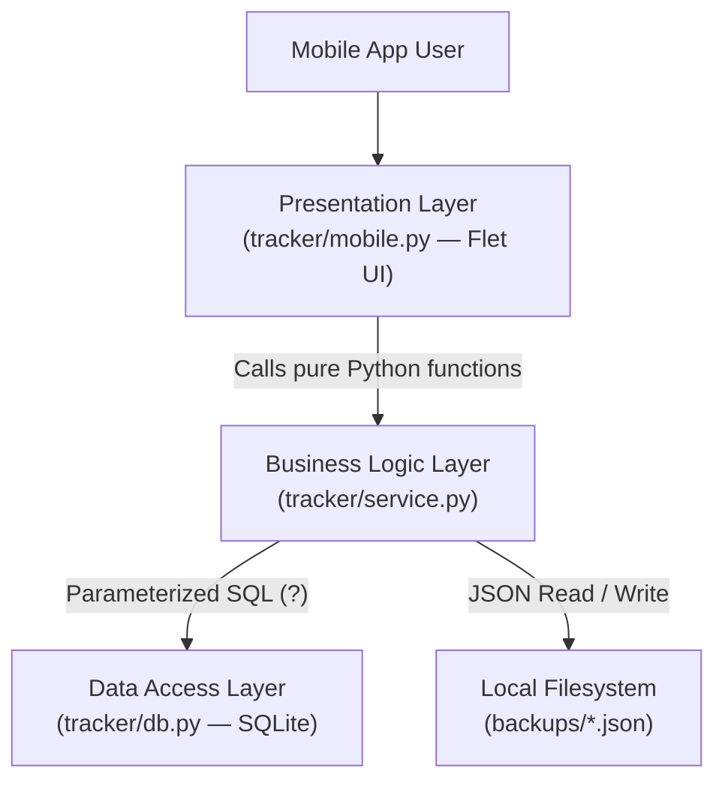
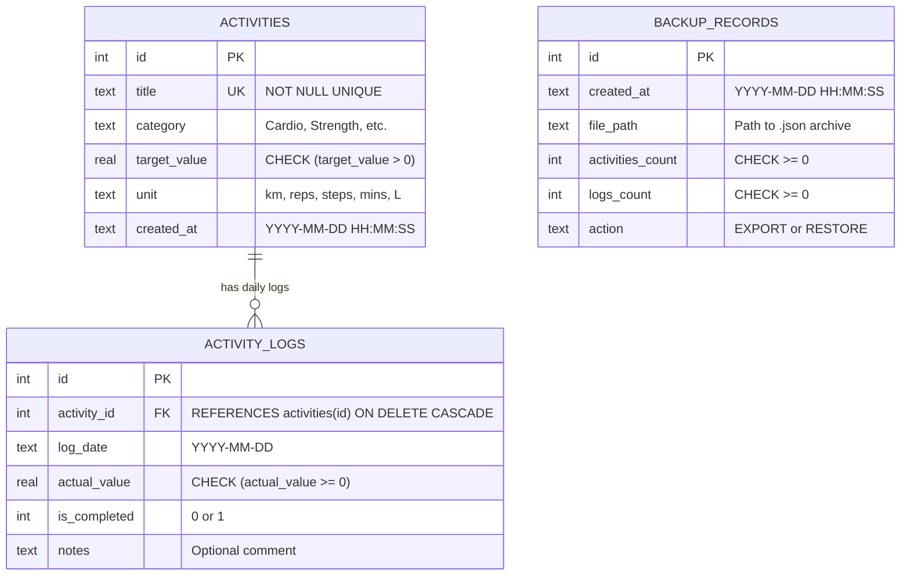

# Document 3: Architecture Description

**Standard Reference:** ISO/IEC/IEEE 42010:2022  
**Project Title:** Physical Activity Tracker with Habit Streaks (*Option #28*)

---

## 1. System Purpose and Context

**HabitStreak** is structured around a strict **Three-Tier Clean Architecture** (Presentation / Interface Layer $\rightarrow$ Business Logic Layer $\rightarrow$ Data Storage Layer). This guarantees that the core domain logic (`tracker/service.py`) is 100% decoupled from the GUI framework (`flet`).

---

## 2. Structural & Component View

| Layer | Module | Responsibility |
| :--- | :--- | :--- |
| **Entry Point** | `main.py` | Root entry point required by `flet run` and `flet build apk`. |
| **Presentation (UI)** | `tracker/mobile.py` | Renders the 4-tab mobile layout (`420 × 860`), captures user inputs, catches `TrackerError`, and displays status banners. |
| **Business Logic** | `tracker/service.py` | Validates inputs, computes consecutive day streaks, aggregates 7-day weekly reports, and executes atomic JSON backups/restores. |
| **Storage Engine** | `tracker/db.py` | Manages SQLite connections, enables `PRAGMA foreign_keys = ON`, and initializes the 3 relational tables. |

---

## 3. Database Schema & Entity-Relationship Diagram (ERD)

### Relational Integrity & Date Ordering
* **One-to-Many Relationship:** One `activities` record owns many `activity_logs` records. `ON DELETE CASCADE` ensures deleting a habit removes orphaned logs automatically.
* **Unique Daily Constraint:** `UNIQUE(activity_id, log_date)` ensures at most one log entry exists per habit per calendar day. Logging twice on the same date performs an SQLite `ON CONFLICT DO UPDATE` (upsert).
* **ISO-8601 Date Strings (`YYYY-MM-DD`):** Storing dates in `YYYY-MM-DD` format allows chronological sorting and range filtering (`WHERE log_date >= ? AND log_date <= ?`) directly in SQLite.

---

## 4. Key Architectural Decisions

### 4.1 Consecutive Day Streak Algorithm
Given a sorted list of unique completed dates $D = [d_1, d_2, \dots, d_k]$ where `is_completed = 1`:
1. **Longest Streak (`_compute_longest_streak`):** Iterates through $D$ checking whether $(d_i - d_{i-1}).\text{days} == 1$. If true, increments the running chain and updates the maximum; otherwise resets the running chain to $1$.
2. **Current Streak (`_compute_current_streak`):** Anchors at `reference_date` (today or the latest logged date). If `anchor` is in $D$, counts backwards day-by-day while `cursor` $\in D$. If `anchor` is not yet completed today, checks `anchor - 1 day` so an active streak from yesterday is preserved until the end of today. Because Python `datetime.date` arithmetic handles calendar lengths, month rollovers and leap years (`Dec 31` $\rightarrow$ `Jan 1`, `Feb 28/29` $\rightarrow$ `Mar 1`) are handled accurately.

### 4.2 Atomic JSON Backup & Restore (Complication)
To prevent partial or corrupted restores from wiping user data:
* `restore_backup()` parses and validates the JSON structure before modifying the database.
* All `DELETE` and `INSERT` statements execute within a transaction. If any record fails validation or triggers an SQLite constraint error, `db.rollback()` restores the database to its exact prior state.

### 4.3 Why SQLite Instead of PostgreSQL?
In accordance with Section 1.5.6 of the study guide:
* **Justification:** SQLite is serverless, zero-configuration, and stores the entire database in a single local file (`activity_tracker.sqlite`), which is ideal for an offline mobile application with a single local user.
* **Known Limitation:** SQLite allows only one concurrent writer process at a time. If the system were scaled to a multi-user cloud API with thousands of concurrent mobile clients, PostgreSQL would be used instead.

---

## 5. Deployment View & Mobile Permissions

* **Desktop / Development Mode:** Launched via `flet run tracker/mobile.py` or `python3 main.py`.
* **Android Mobile Package (APK):** Compiled via `flet build apk`.
* **Mobile Permissions Justification (Section 1.4.1):**
  * **Internal App Storage (Default):** Used to store `activity_tracker.sqlite` and local `.json` backups inside the application sandbox.
  * **No Unnecessary Permissions:** The app does **not** request camera, microphone, contacts, or background GPS location permissions, adhering strictly to the principle of least privilege (Section 1.5.4).
